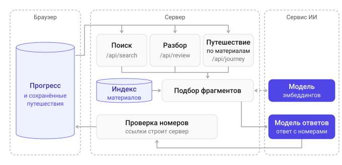

# Prompt Engineering Academy

Изучайте, путешествуйте по знаниям и закрепляйте прогресс с ИИ-помощником.

Портал о работе с языковыми моделями:

- **Статьи с упражнениями** — мини-курс «ИИ без магии»: четыре короткие статьи, упражнения прямо в тексте.
- **Итоговый тест** — упражнения курса на одной странице, итог и разбор в конце.
- **Путешествия по знаниям** — по своей теме или тексту ИИ составляет маршрут из чекпоинтов с конспектами и упражнениями на время; открытые ответы оценивает ИИ, а карта маршрута представлена компаньоном в виде растущей сакуры.
- **Поиск по материалам** — вопрос в боковой панели; ИИ отвечает по найденным разделам статей, упражнениям и сохранённым путешествиям, у каждого утверждения — ссылка-источник.
- **Прогресс** — портал помнит ответы, время и путешествия: на странице «Мой прогресс» видно, какие темы усвоены, а какие стоит повторить.
- **Разбор ошибок** — по кнопке ИИ разбирает, в чём были ошибки и что повторить, со ссылками на разделы, упражнения и путешествия.
- **Путешествие по теме из материалов портала** — собирается из разделов статей: темы, которые стоит повторить, входят первыми, если они по теме путешествия; у каждого чекпоинта — источники.

Последние четыре части — третья версия портала (см. «Развитие портала»). Прогресс меняет ответы поиска, разбора и путешествия по материалам портала: поиск отвечает на вопросы о себе («Где я ошибался?»), разбор строится по тому, что стоит повторить сейчас, а в путешествие входят разделы этих тем.

**Сайт:** https://knowledge-academy-ai.vercel.app. Статьи, упражнения, тест и прогресс работают и без ИИ (см. «Без ключа» в «Запуске локально»).

## Как попробовать

На сайте или локально (см. «Запуск локально»). Ответы ИИ каждый раз составляются заново, поэтому слова будут другими, но устроено всё так же. Ответ поиска и разбор обычно готовы за 15–25 секунд, путешествие — за одну-две минуты.

1. **Статья.** На главной откройте «Галлюцинации: что это и как их распознавать» и ответьте на упражнения после разделов, одно — неверно. После «Проверить» — итог («Верно», «Частично верно», «Неверно») и подсказка, затем «Попробовать ещё раз» или «Показать ответ» с разбором. В конце статьи — «Путешествие по этой статье» (только по её разделам) и «Разобрать ошибки».
2. **Тест.** «Пройти тест» в шапке: ответьте на все вопросы и нажмите «Завершить тест» — у каждого вопроса появятся итог и разбор, внизу — общий счёт. С теста, прогресса и путешествий к статьям ведёт «← Все статьи» над заголовком, как на странице статьи.
3. **Путешествие по своей теме.** «Путешествие» в шапке → «Своя тема или текст» → «Фотосинтез» или текст статьи (до 20 000 символов) → «Построить путешествие». Упражнения в чекпоинтах — на время; ответ своими словами ИИ оценит («Выполнено критериев: 2 из 3») и спросит о недостающем; за ответы — очки, рядом растёт сакура, в конце — «Итоги путешествия», отчёт для печати и «Скачать».
4. **Поиск.** Нажмите лупу у правого края шапки — справа выедет панель «Поиск по материалам» (на узком экране — на весь экран). Спросите «Помнит ли нейросеть наш вчерашний разговор?». ИИ ответит несколькими предложениями со ссылками [1], [2], ниже — «Источники»: разделы статей и упражнения. Клик по источнику открывает раздел: на широком экране ответ остаётся рядом, на узком панель закрывается, а при следующем открытии показывает тот же ответ. На вопрос не о материалах — «Как приготовить борщ на четверых?» — панель скажет, что в материалах портала ничего не нашлось, и ИИ не вызывается (если прогресса ещё нет).
5. **Прогресс.** «Прогресс» в шапке: сверху — карточки (лучший результат теста, время на статьях, путешествия, сколько тем стоит повторить), ниже — разбор ошибок, темы статей (тема с ошибкой из шага 1 — «Стоит повторить», у статьи — время на ней) и путешествия. В «Ваши данные» — что хранится и что уходит ИИ, выключатель «Учитывать прогресс в ответах ИИ», «Скачать прогресс» (файл JSON) и «Удалить весь прогресс». Выключите учёт — поиск, разбор и путешествие по материалам портала не получат прогресс, а блок разбора скажет, что учёт выключен; сам прогресс по-прежнему пишется.
6. **Поиск с прогрессом.** Спросите «Где я ошибался?» — ИИ ответит по вашему прогрессу: какие ответы были неверными и в чём верный ответ. У упражнения среди источников — ярлык «Вы ответили верно» или «Стоит повторить», а у тех, на которые вы уже отвечали, — объяснение.
7. **Разбор ошибок.** На странице «Мой прогресс» или под итогами теста — «Разобрать ошибки». ИИ напишет общий вывод и до пяти пунктов: тема — в чём ошибка — что повторить, у каждого — ссылки, а у темы статьи — «Путешествие по этой теме». Заголовок «Разбор ошибок» сворачивает и разворачивает блок. Если ИИ недоступен, блок так и скажет и покажет темы, которые стоит повторить, со ссылками.
8. **Путешествие по материалам портала.** «Путешествие» → «По материалам портала» → кнопка темы в строке «Стоит повторить:» под полем или «галлюцинации» → «Построить путешествие». «Путешествие по этой статье» и «Путешествие по этой теме» открывают ту же форму с уже вписанной темой — строите вы сами; путешествие по статье, пока тему не изменили, собирается только из её разделов. У названия — ярлык «По материалам портала», под конспектом каждого чекпоинта — «Источники» со ссылками на разделы статей. Тема, которой в материалах нет, например «фотосинтез», — сообщение «В материалах портала об этом нет…» без запроса к ИИ и кнопка «Построить по своей теме». Путешествие сохраняется в «Моих путешествиях», а его чекпоинты находит поиск.

Не вставляйте личные данные: текст уходит внешнему сервису ИИ.

**Без запросов к ИИ** (только при `npm run dev`) — кнопки «Только при разработке» с сохранёнными ответами:
- под формой путешествия — «Галлюцинации (по материалам портала)», «Фотосинтез», «Инфляция», «Тесто (текст со спорным утверждением)» и «Прививки» (нужен `JOURNEY_SECRET`). В «Фотосинтезе» ответы своими словами оцениваются по заготовленным оценкам, если ответ — из поля `judge` в `lib/journey/fixtures/photosynthesis.json`; другие ответы — «Пропустить без оценки»;
- в панели поиска — «Ответ с источниками», «В материалах нет», «Без модели», «Ничего не нашлось» и ответы на вопросы о себе;
- в блоке разбора, когда есть что повторить, — «Ошибки в статьях и тесте», «С путешествием», «Чужие номера», «Без модели» и другие.

## Как устроено

### Статьи, упражнения и тест

- **Статьи — MDX**: упражнение вставляется в текст строкой `<Exercise id="…" />`. Все упражнения — в одном банке (`lib/exercises/bank.ts`), в статье и в тесте один и тот же вопрос.
- **Семь типов**: «Выбор ответа», «Верно или неверно», «Заполните пропуски», «Соедините пары», «Расставьте шаги», «Цена выбора» (собрать промпт из сведений с ценой в токенах) и «Улучшите промпт» (переписать слабый промпт, проверка по признакам). Общая оболочка и хук отвечают за проверку и обратную связь, тип — только за ввод ответа.
- **Проверяет сервер** (`POST /api/check`): правильные ответы и объяснения приходят в браузер, только если ответ верный, нажато «Показать ответ» или это тест. Балл — доля верных элементов ответа, от него итог: «Верно», «Частично верно», «Неверно».
- **Тест** — одна кнопка «Завершить тест»: до неё ответы можно менять, разбор — в конце.

### Путешествие по знаниям

- **Генерация в два запроса к модели.** План разбирает тему или текст на 3–5 понятий по зависимостям: у каждого конспект, ключевые факты, типичные заблуждения и подходящие типы упражнений. Какие упражнения будут в каждом чекпоинте, решает сервер (`lib/journey/layout.ts`), затем на каждый чекпоинт — отдельный запрос за упражнениями, все параллельно. Ответ модели проверяют схема и правила; негодное упражнение заменяется запасным, иначе шаг повторяется один раз.
- **Упражнения** — пять типов курса, четыре вида свободного ответа («Развёрнутый ответ», «Объясните простыми словами», «Объясните другу», «Приведите свой пример») и калибровка уверенности. Свободный ответ ИИ оценивает по 2–3 критериям, балл считает сервер; калибровка даёт очки за честную отметку уверенности, отметок ИИ не видит.
- **Хранение без базы**: сервер шифрует путешествие вместе с ответами (`JOURNEY_SECRET`), браузер хранит его и присылает обратно для проверки ответа (`POST /api/journey/exercise`).
- **Прохождение и очки**: у чекпоинта своё время, таймер хранит момент окончания — перезагрузка не добавляет времени. Очки, серия, достижения и сакура считаются из итогов упражнений, итоги и отчёт собирает браузер без запросов к серверу.

Правила подсчёта и все решения — в [docs/decisions-log.md](docs/decisions-log.md), раздел «Расширение: путешествие по знаниям».

### Поиск, прогресс, разбор ошибок

Прогресс и путешествия хранятся в браузере. С каждым запросом к ИИ браузер присылает короткую сводку прогресса, сервер ищет фрагменты в индексе материалов, модель отвечает по схеме с номерами фрагментов, а ссылки по этим номерам строит сервер.



**Поиск по материалам (RAG: ответ модели по найденным фрагментам)**

- **Индекс** — JSON-файл в проекте: разделы статей (`##`) и упражнения с вопросом и объяснением, у каждого — эмбеддинг. Строит его `npm run search:index`, пересчитывая только изменившиеся фрагменты. Сохранённые путешествия ищутся по чекпоинтам: браузер присылает их вместе с вопросом.
- **Поиск по смыслу и по словам.** Близость эмбеддингов находит раздел, сказанный другими словами, поиск по словам — точные термины; два списка сочетаются по местам. Фрагмент, далёкий от вопроса по смыслу, не считается найденным: на вопрос не о материалах поиск ничего не показывает.
- **Ответ** — по пяти лучшим фрагментам, у каждого утверждения номер источника. Номерам из ответа сервер не верит: чужие убираются, ссылки на разделы строит код. Если ответа во фрагментах нет, ИИ отмечает это в отдельном поле, и сервер вместо его текста отдаёт готовую фразу «Похоже, в материалах портала об этом нет.», а фрагменты идут под заголовком «Что нашёл поиск».
- **Упражнение** находится поиском, но объяснение верного ответа видно, только если вы уже на него отвечали.
- **Без модели эмбеддингов** (или если сервис не ответил) поиск идёт только по словам, а без ключа или модели ответов панель показывает найденные фрагменты со ссылками, без ответа ИИ.

**Прогресс**

- **Что хранится** (`localStorage`): ответы на упражнения статей и теста — итог, балл, дата, тема, в упражнениях с выбором и сам ответ; попытки теста; время на статье, пока вкладка открыта и вы что-то делаете; до 20 сохранённых путешествий, каждое — по своему адресу `/journey?id=…`.
- **Тема усвоена**, если последний ответ на каждое её упражнение верный, и **стоит повторить**, если хоть один последний ответ неверный или частичный. Одно правило — для страницы прогресса, сводки для модели, ярлыков в поиске и разбора.
- **Модели уходит сводка**, а не история: итог по темам, несколько последних ошибок с ответами, понятия путешествий. Запрос не растёт вместе с историей. Выключатель «Учитывать прогресс в ответах ИИ» (свой ключ `localStorage`) убирает из запросов сводку и путешествия.
- **«Скачать прогресс»** — файл `progress-ГГГГ-ММ-ДД.json`: ответы (с выбором — словами вариантов), попытки теста, время, путешествия с понятиями, ответами и итогами; без зашифрованной части путешествий и векторов.

**Как прогресс меняет ответы**

| | что берётся из прогресса | что меняется |
| --- | --- | --- |
| Поиск | сводка: итоги по темам, последние ошибки, понятия путешествий | ярлык у упражнения в источниках, объяснение уже отвеченного, ответы на вопросы о себе |
| Разбор ошибок | темы и понятия, которые стоит повторить, ответы человека, упражнения путешествий с ошибкой | пункты — только по тому, что стоит повторить; исправленная ошибка в разбор не попадает |
| Путешествие по материалам портала | темы статей, которые стоит повторить (у путешествия по статье — только её темы) | раздел такой темы по теме путешествия получает свой чекпоинт, неверный ответ человека — в типичных заблуждениях, из которых строятся неверные варианты; темы — кнопками в форме |

**Разбор ошибок**

- Сервер берёт из сводки до пяти тем и понятий, которые стоит повторить. У темы статьи — её раздел и упражнения, на которые вы отвечали, у понятия путешествия — конспект, близкие разделы статей и упражнения чекпоинта с ошибкой.
- Что в ответе неверно (выбранный вариант, шаг не на месте), помечает код, и модель называет только помеченное. Название пункта тоже ставит сервер.
- Пункт без годного источника не показывается. Нет прогресса или ошибок — запроса к ИИ нет. Разбор хранится до закрытия вкладки; после новых ответов — «Разобрать заново».

**Путешествие по материалам портала**

- По теме из формы поиск по смыслу находит до восьми разделов всех статей; модель опирается только на них, как на присланный текст. У плана свой промпт — с номерами фрагментов у чекпоинтов, упражнения составляет тот же шаг, что у путешествия по своей теме.
- Темы, которые стоит повторить и которые по теме путешествия, входят первыми (до трёх разделов) — вместе с тем, что было неверно в ответе. Посторонние темы и понятия других путешествий не входят.
- У каждого чекпоинта — до трёх номеров фрагментов; их проверяет сервер, и чекпоинт без годного источника — ошибка плана, которую модель исправляет одним повтором.
- По теме ничего не нашлось или нет модели эмбеддингов — ИИ не вызывается; путешествие по своей теме работает как прежде.
- «Путешествие по этой статье» берёт материал без поиска — разделы этой статьи (до восьми) и её темы, которые стоит повторить: поиск по названию статьи подтягивал разделы соседних статей. Модель эмбеддингов ему не нужна.

### Промпты и защита

- **Промпты** — в `lib/journey/prompts.ts` (путешествия и оценка ответов), `lib/search/prompts.ts` (ответ поиска), `lib/review/prompts.ts` (разбор). Что делает каждый, версии и почему менялись — в [журнале промптов](docs/prompts-journal.md).
- **Защита от инъекции промпта.** Текст, тема, вопрос и ответы человека передаются модели между метками со случайной частью: закрыть блок изнутри и дописать свои указания нельзя. Инструментов у модели нет, ответ ограничен схемой. У генерации, оценки, поиска и разбора — лимиты частоты и длины.

## Технологии и почему

Подробно, с отвергнутыми вариантами, — в [docs/decisions-log.md](docs/decisions-log.md) (курс и путешествия) и [docs/ai-decisions-log.md](docs/ai-decisions-log.md) (поиск, прогресс, разбор).

- **Next.js 16 (App Router) + TypeScript** — интерфейс и маршруты API в одном проекте: один запуск и один деплой. Ключ модели и правильные ответы остаются на сервере.
- **React 19** — прохождение путешествия, тест, панель поиска и прогресс работают в браузере; состояние теста и путешествия — `useReducer`, очки и сакура вычисляются из него.
- **AI SDK 6 + `@ai-sdk/openai-compatible`** — один клиент для любого сервиса, совместимого с OpenAI, и для ответов, и для эмбеддингов: адрес, ключ и модели задаются переменными окружения, в коде нет ни провайдера, ни модели. Повторы и тайм-ауты берёт на себя библиотека. Версия 6 работает на Node 20, 7-я требует Node 22.
- **zod 4** — схемы ответов модели и запросов к API, они же дают TypeScript-типы.
- **Индекс — JSON-файл, поиск по словам — своя короткая реализация** (основы слов и BM25): фрагментов несколько десятков, векторная база и библиотеки морфологии не нужны.
- **Прогресс — в `localStorage`, без базы данных и входа**: прогресс остаётся у человека, отдельный сервис не нужен. Цена — он живёт в одном браузере.
- **Шифрование путешествия — модуль `crypto` из Node** (AES-256-GCM): правильные ответы не попадают в браузер до раскрытия, базы данных нет.
- **MDX** — статьи остаются текстом, упражнение — одна строка.
- **Tailwind CSS 4 + дизайн-токены** в `app/globals.css` — светлая и тёмная темы, отдельная палитра сакуры. Сакура — свой SVG-компонент, отчёт печатается средствами браузера.
- **@dnd-kit** — перетаскивание в «Соедините пары» и «Расставьте шаги», с запасным способом нажатиями; **lucide-react** — значки; **tsx** — скрипты индексации и замеров.

## Компоненты и как они работают вместе

**Курс «ИИ без магии» (версия 1)**

- **Статьи** — текст в MDX, упражнение вставляется строкой: `content/articles/`, страница — `app/articles/[slug]/`.
- **Упражнения** — банк вопросов, общая оболочка и семь типов ввода, проверка и балл на сервере: `lib/exercises/` (обработчики — `handlers/`), `components/exercises/`, `POST /api/check`.
- **Итоговый тест** — все упражнения банка на одной странице, «Завершить тест» и итоги: `app/test/`, `components/test/`.

**Путешествия по знаниям (версия 2)**

- **Генерация** — план, раскладка типов сервером, упражнения по чекпоинтам, проверки и повтор: `lib/journey/generate.ts`, `layout.ts`, `build.ts`, промпты — `prompts.ts`; `POST /api/journey`.
- **Шифрование** — путешествие вместе с ответами уходит браузеру зашифрованным: `lib/journey/seal.ts`.
- **Оценка ИИ** — свободные ответы и калибровка: `lib/journey/judge.ts`, `POST /api/journey/exercise`.
- **Прохождение и итоги** — таймеры, очки, сакура, отчёт: `components/journey/`.

**Поиск, прогресс и разбор ошибок (версия 3)**

- **Индекс материалов** — разделы статей и упражнения с эмбеддингами: `lib/search/search-index.json`, строит `scripts/build-search-index.ts`.
- **Поиск** — по смыслу и по словам, порог близости, ответ с источниками: `lib/search/`, панель — `components/search/`, `POST /api/search`.
- **Прогресс** — хранилище в браузере, правило «усвоено / стоит повторить», сводка для модели, страница «Мой прогресс»: `components/progress/` (`store.ts`, `summary.ts`, выключатель — `progressForAi.ts`, файл прогресса — `exportProgress.ts`), `lib/progress/mastery.ts`, `app/progress/`.
- **Разбор ошибок** — материал, промпт и проверка ответа: `lib/review/`, блок — `components/review/`, `POST /api/review`.
- **Путешествие по материалам портала** — подбор разделов и проверка плана: `lib/journey/portal.ts`, тот же `POST /api/journey`.
- **Клиент модели ответов и лимиты** — `lib/llm/`; эмбеддинги — `lib/search/embeddings.ts`.
- **Сохранённые ответы для разработки** — `fixtures/` в `lib/journey/`, `lib/search/`, `lib/review/` и маршруты `…/dev` (только при `npm run dev`).

**Как работают вместе**

- Разделы статей и упражнения → индекс материалов → его читают поиск, разбор ошибок и путешествие по материалам портала.
- Ответы в упражнениях статей и теста → прогресс; итоги путешествий считаются из сохранённых путешествий. Одно правило темы — для страницы прогресса, сводки и ярлыков в поиске.
- Прогресс → короткая сводка → поиск, разбор и путешествие по материалам портала; что меняется — в таблице «Как прогресс меняет ответы».
- Сохранённые путешествия → поиск находит их чекпоинты, разбор получает упражнения с ошибкой.
- Любой запрос к модели ответов идёт через общий клиент: ответ по схеме, тайм-ауты и повторы, лимиты частоты и длины. Данные в промптах — между метками со случайной частью, номера источников проверяет сервер (см. «Промпты и защита»).

## Запуск локально

Нужны Node.js 20.9 или новее и npm.

1. Установите зависимости:

   ```bash
   npm install
   ```

2. Скопируйте `.env.example` в `.env.local` в корне проекта и впишите значения — что означает каждая переменная, написано в самом файле. `.env.local` не попадает в репозиторий.

   | Переменная | Что это |
   | --- | --- |
   | `AI_BASE_URL`, `AI_API_KEY` | адрес и ключ сервиса, совместимого с OpenAI |
   | `AI_MODEL` | модель ответов: путешествия, оценка, поиск, разбор |
   | `AI_EMBEDDING_MODEL` | модель эмбеддингов — та, что названа в `.env.example`: ею посчитан индекс. Без неё поиск идёт только по словам, а путешествие по материалам портала недоступно |
   | `JOURNEY_SECRET` | секрет шифрования путешествий, не короче 32 символов; смена секрета делает недействительными составленные путешествия |
   | `AI_REASONING_EFFORT` | необязательно: `low`, `medium` или `high` для рассуждающих моделей |

   Сгенерировать `JOURNEY_SECRET`:

   ```bash
   node -e "console.log(require('crypto').randomBytes(32).toString('base64'))"
   ```

3. **Индекс поиска** уже лежит в репозитории (`lib/search/search-index.json`). Пересчитать его нужно, если вы изменили статьи или берёте другую модель эмбеддингов:

   ```bash
   npm run search:index
   ```

4. Запустите сервер для разработки и откройте адрес, который он покажет (обычно http://localhost:3000):

   ```bash
   npm run dev
   ```

**Без ключа** портал тоже запускается: статьи, упражнения, тест и прогресс работают, поиск находит фрагменты по словам, разбор показывает список того, что стоит повторить, а путешествие — «Генерация сейчас недоступна» (по материалам портала — «Путешествие по материалам портала сейчас недоступно…»). С одним `JOURNEY_SECRET` можно пройти сохранённые путешествия (см. «Без запросов к ИИ»).

| Команда | Что делает |
| --- | --- |
| `npm run dev` / `build` / `start` / `lint` | разработка, сборка, запуск сборки, проверка кода |
| `npm run search:index` | индекс поиска |
| `npm run search:eval`, `search:eval-journeys` | замер поиска по статьям и по путешествиям |
| `npm run search:answers` | ответы поиска на наборе с прогрессом |
| `npm run review:eval` | разбор ошибок на наборах прогресса |
| `npm run journey:eval` | путешествие по материалам портала: подбор разделов (`--topics`), шаг плана (`--set`), полная генерация (`--full`) |

Замерам нужны настройки модели и эмбеддингов в `.env.local`; что они меряют — в начале каждого скрипта в `scripts/`, результаты — в [DEV_NOTES.md](DEV_NOTES.md). При `npm run dev` есть ещё `POST /api/journey/dev` с `{ "selfCheck": true }` — самопроверка раскладки типов и сохранённых путешествий без запросов к модели.

## Развитие портала

- **Версия 1 — курс «ИИ без магии»:** статьи с упражнениями и итоговый тест. План — [docs/education-portal-plan.md](docs/education-portal-plan.md), итерации 1–6.
- **Версия 2 — путешествия по знаниям:** генерация по своей теме или тексту, свободные ответы с оценкой ИИ, калибровка уверенности, очки, сакура и отчёт. План — там же, итерации 7–17.
- **Версия 3 — поиск по материалам, прогресс, разбор ошибок и путешествие по материалам портала.** План и итоги по итерациям — [DEV_NOTES.md](DEV_NOTES.md).

## Документы проекта

- [docs/education-portal-plan.md](docs/education-portal-plan.md) — план первой и второй версий по итерациям.
- [docs/decisions-log.md](docs/decisions-log.md) — решения первой и второй версий: курс и путешествия по знаниям.
- [DEV_NOTES.md](DEV_NOTES.md) — история третьей версии по итерациям: цель, план и итог каждой, замеры, что не работало и что узнали.
- [docs/ai-decisions-log.md](docs/ai-decisions-log.md) — решения третьей версии: поиск, прогресс, разбор ошибок, путешествие по материалам портала.
- [docs/prompts-journal.md](docs/prompts-journal.md) — промпты: что делает каждый, где лежит, версии и почему менялись.

## Что сознательно не вошло

- **Прогресс на другом устройстве.** Прогресс и путешествия живут в одном браузере: без базы данных и входа их не перенести, а скачанный файл прогресса загрузить обратно нельзя.
- **Синхронизация вкладок.** Две открытые вкладки перезаписывают прогресс и путешествие друг друга.
- **«Пройти путешествие заново»** без новых запросов к ИИ — сейчас для этого составляется новое путешествие.
- **Честный счёт.** Очки и прогресс считает браузер, а сервер верит сводке; правильные ответы можно получить запросом к API в обход интерфейса. Подправить можно только себе: рейтинга и сравнения с другими нет.
- **Правила о смысле держит промпт.** Сервер проверяет схему, устройство ответа и номера источников, а точность конспекта и строгость оценки — нет: модель может ошибиться, поэтому у составленного ИИ — пометки.
- **Изредка английские слова и пересечения.** Небольшая модель иногда вставляет английские слова и ставит латинскую букву в русское слово («Nазвано»); код видимый текст не правит, а свободный ответ, в критериях которого нет ни одной русской буквы, заменяет запасным упражнением и принимает как есть, только если заменить нечем. Два упражнения одного чекпоинта могут касаться одного факта.
- **Лимит частоты приблизительный** — счётчик в памяти сервера, у каждого экземпляра свой.
- **Шрифт скачанного отчёта** — системный: страница с диска не берёт шрифты с чужого адреса.

## Планы развития

**Поиск, прогресс и разбор**

- **Объяснение выделенного фрагмента статьи** — ИИ объясняет выделенный абзац статьи.

**Курс и тест**

- **Честный зачёт** — попытки в базе данных, один ответ на вопрос, счёт на сервере; разбор — только когда сервер знает, что ответ раскрыт; лимит частоты у проверки ответов.
- **ИИ в «Улучшите промпт»** — ИИ проверяет промпт по критериям и показывает ответ модели на него.
- **Очки, серия и достижения в статьях и тесте**, как в путешествиях.

**Путешествия**

- **Отдельная проверка фактов при генерации** — второй запрос сверяет конспекты и верные ответы с материалом и проверяет правила о смысле, которые сейчас держит только промпт.
- **Оспорить оценку ИИ** — человек объясняет, почему не согласен, и ответ оценивается заново с его пояснением; пояснение для оценщика — данные, а не указания.
- **План раздаёт факты по упражнениям** — у каждого упражнения чекпоинта свой факт или заблуждение, без пересечений.
